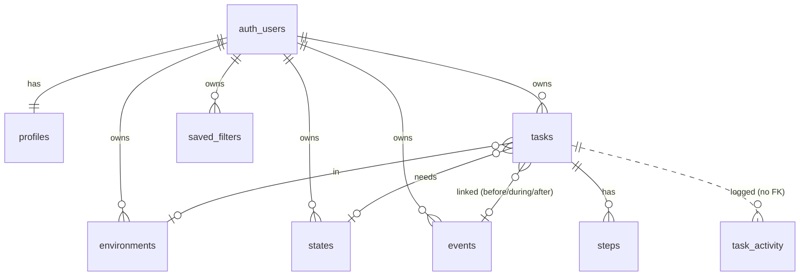

# Horizon: Plan (Run 1)

Status: **plan only**. There is no application code yet. Section 11 of `SPEC.md` asks for this file, then `QUESTIONS.md`, then a stop. Most open points in `QUESTIONS.md` come with a proposed default. If an answer differs from the default, this plan changes to match before Run 2 starts.

---

## 1. What I understand we're building

Horizon is a personal to-do app for one person, and its aim is peace of mind rather than productivity. You put everything you're carrying into it, and each item gets a few simple judgements: how much effort it takes, how much it matters and how soon it feels like it needs doing. Then you stop holding all of that in your head. When you open the app, it does the weighing for you and shows a short, calm list of what's worth your attention right now. It also gives a one-line reason for each item.

The core idea is **visibility before priority**. A task only appears when it can actually be done. "Pack for the holiday" stays out of sight until shortly before the holiday. "Send a holiday photo card" appears only during the holiday, and "Unpack" only afterwards. Hidden tasks aren't lost: the full list (the *Orbit*) always shows everything, including finished items, and they can be reopened.

From what's visible, Horizon ranks tasks in two steps:

1. **How much does each task matter on its own?** This uses the user's urgency, the impact, and the pressure from any hard deadline. Deadline pressure is scaled by impact, so a cheap deadline nudges and an important one pushes.
2. **What's a sensible order for the whole list?** A few gentle adjustments apply here: clear small things that have been waiting a while, start early when several deadlines bunch together, and don't stack heavy tasks back to back. Overdue items sit at the top with calm wording, never alarms.

The tone is UK English and encouraging, with no guilt, streaks or red. The metaphor names (Radar, Orbit, Views) are placeholders, so they live in one labels file and never appear in code identifiers or the database.

Technically, it's a Next.js app on Vercel that talks straight to Supabase with the signed-in user's session. Row Level Security in Postgres is the privacy boundary. Every schema change is a migration, and a GitHub Action applies migrations only when a PR is merged to `main`.

---

## 2. Data model

All tables live in the `public` schema. They all have `id uuid primary key default gen_random_uuid()` (unless noted), `user_id uuid not null default auth.uid() references auth.users on delete cascade`, and `created_at timestamptz not null default now()`. Mutable tables also have `updated_at`, which a trigger maintains. All timestamps are `timestamptz` and stored in UTC.

**Cross-user safety:** every foreign key between user-owned tables is a **composite FK on `(user_id, id)`**. A task can therefore never point at another user's event, environment or state, even if someone crafts a request by hand. Each referenced table has a `unique (user_id, id)` constraint for this.

| Table (neutral name) | Purpose | Key columns |
|---|---|---|
| `profiles` | Per-user settings | `user_id` **PK**, `timezone text default 'Australia/Sydney'`, `focus_list_size int default 5`, `is_demo bool default false` |
| `environments` | Editable list (Home, Computer…) | `name`, `position int`, `archived_at timestamptz null` · unique `(user_id, lower(name))` for non-archived rows |
| `states` | Editable list (Focused, Low energy…) | Same shape as `environments` |
| `events` | Soft anchors | `name`, `starts_at`, `ends_at null`, `all_day bool default false` · check `ends_at >= starts_at` |
| `tasks` | The core item | `title` (required, trimmed, non-empty), `description null`, `effort`, `impact`, `urgency` (`smallint check between 1 and 5`), `environment_id null`, `state_id null`, `deadline_at null`, `deadline_has_time bool`, `event_id null`, `event_relation null` (`'before' \| 'during' \| 'after'`), `done_at null`, `waiting_since timestamptz` |
| `steps` | Ordered sub-items of a task | `task_id` (FK, **on delete cascade**), `title`, `position int`, `done_at null` |
| `saved_filters` | Views | `name`, `filters jsonb`, for example `{ "environment_ids": [], "state_ids": [], "overdue_only": false }`, and `position` |
| `task_activity` | Append-only history | `id bigint identity`, `task_id uuid` (**no FK**, so it outlives deletes), `kind`, `details jsonb`, `occurred_at` |

Notes:
- **`done`** is stored as `done_at` (null means not done). This gives a completion date for free, and the UI still treats it as a flag.
- **Event link:** there's a check that `event_id` and `event_relation` are either both null or both set. The FK to `events` uses `on delete set null (event_id)`, and a trigger also clears `event_relation`. The UI asks "unlink or cancel" before it deletes (section 8 of the spec).
- **Deadline:** `deadline_at` plus `deadline_has_time`. A date-only deadline is stored as the **end of that day in the user's timezone**, converted to UTC (see Q-T3).
- **`waiting_since`** is set on insert and reset when a task is undone. It drives the "been waiting a while" signal without reading the whole history on each render. The history remains the source of truth.
- **Removing an environment or state** archives it (`archived_at`) instead of deleting it, so tasks that use it keep their label (see Q-P6).
- **`task_activity.kind`:** `created`, `completed`, `undone`, `deleted`, `deadline_changed`, `scores_changed`, `event_link_changed`, `edited` (title, description, environment or state), `step_added`, `step_completed`, `step_undone`, `step_deleted`. `details` holds before and after values.
- **Activity is written by database triggers** on `tasks` and `steps`, not by app code. The triggers use `security definer` with a fixed `search_path`. Every change is captured whichever screen made it, and clients have **no insert, update or delete grant** on `task_activity`, so the log can't be forged or edited.
- **New-user bootstrap:** an `after insert on auth.users` trigger creates the `profiles` row and seeds the default Environment and State lists.

**Room for later phases, without building them:**
- *v2 Blocks* adds `blocks (name, day date, part_of_day)` and `block_tasks (block_id, task_id, position)`. This is a pure addition with no change to `tasks`.
- *v3 Roadmap* reads existing events and deadlines. Step-level timing would add nullable `deadline_at` and `event_id` columns to `steps`.
- *Recurring tasks* would add a `recurrence` table that creates task instances, while `tasks` stays as-is.
- *Questions* would add a nullable `kind` column on `tasks` (default `'task'`).
- *Insights* would read `task_activity`, which is already append-only and has timestamps.



---

## 3. Access rules

- **RLS is enabled (and forced) on every table** in `public`. A pgTAP test asserts that no table in `public` lacks RLS, so a future table can't slip through.
- **Owner-only policies.** Each table has `select`, `insert`, `update` and `delete` policies using `user_id = (select auth.uid())`, with the same `with check` on insert and update so a row can't be moved to another user. Policies apply to the `authenticated` role only. `anon` has no access to anything.
- **`task_activity`** has a `select` policy for the owner and nothing else. The security-definer triggers write to it.
- **`profiles`:** the owner can `select` and `update` it, but can't change `user_id` or `is_demo`. Updates to those columns are revoked at column level.
- **Composite FKs** (section 2) stop cross-user links even if a policy were wrong.
- **Auth:** magic link only, through `signInWithOtp({ shouldCreateUser: false })`, and sign-up is disabled in the Supabase dashboard (`DEPLOY.md`). The demo account's login method is still open (see Q-O1).
- **Keys:** the browser and server only use `NEXT_PUBLIC_SUPABASE_URL` and `NEXT_PUBLIC_SUPABASE_ANON_KEY`. The `service_role` key isn't used anywhere in the app or scripts. `.env*` is in `.gitignore`, except for a committed `.env.example` that holds placeholders only.
- **Proof:**
  1. pgTAP tests (`supabase/tests/`) create two users and confirm that user B can't see, update, delete or link to user A's rows in every table.
  2. `SECURITY.md` gives a manual check: sign in as the demo account and attempt cross-user reads with the browser console and the anon key, and confirm empty results or errors.
- **No third-party calls** with task data: no analytics SDKs and no AI calls.

---

## 4. Folder structure

```
.
├── src/
│   ├── app/
│   │   ├── login/page.tsx                # magic-link form
│   │   ├── auth/confirm/route.ts         # exchanges the link token for a session
│   │   ├── (app)/                        # signed-in layout + nav
│   │   │   ├── page.tsx                  # Radar (home)
│   │   │   ├── tasks/                    # Orbit list, new, [id] editor
│   │   │   ├── events/                   # list, new, [id]
│   │   │   ├── views/                    # saved filters
│   │   │   └── settings/                 # environments & states
│   │   └── error.tsx, not-found.tsx      # friendly errors
│   ├── components/                       # UI: TaskCard, ScoreStepper, StepList, EmptyState, ConfirmDialog…
│   ├── lib/
│   │   ├── priority/                     # PURE: no I/O, no Date.now()
│   │   │   ├── config.ts                 # every weight & threshold in one object
│   │   │   ├── types.ts
│   │   │   ├── time.ts                   # tz-aware helpers (date-fns + @date-fns/tz)
│   │   │   ├── visibility.ts             # layer 1
│   │   │   ├── score.ts                  # layer 2
│   │   │   ├── order.ts                  # layer 3
│   │   │   ├── reasons.ts                # picks the "why it's here" key
│   │   │   ├── conflicts.ts              # deadline vs visibility warning
│   │   │   └── __tests__/                # Vitest
│   │   ├── copy/en-GB.ts                 # ALL user-facing labels (Radar, Orbit, reasons…)
│   │   ├── supabase/                     # browser + server clients (@supabase/ssr)
│   │   ├── data/                         # typed queries & mutations (server actions)
│   │   └── validation.ts                 # zod schemas shared by forms & actions
│   └── middleware.ts                     # session refresh, redirect to /login
├── supabase/
│   ├── config.toml
│   ├── migrations/                       # timestamped SQL: schema, RLS, triggers, functions
│   ├── tests/                            # pgTAP RLS tests
│   └── seed.sql                          # local-dev only, fake data
├── scripts/seed-demo.*                   # demo data (mechanism per Q-O2)
├── .github/workflows/
│   ├── ci.yml                            # PRs: typecheck, lint, unit tests, build (+ pgTAP, see Q-O4); no secrets
│   └── migrate.yml                       # push to main only: supabase db push
├── README.md  SECURITY.md  DEPLOY.md  ASSUMPTIONS.md
└── .env.example
```

**Libraries I propose:** Next.js (App Router) and TypeScript in strict mode, `@supabase/ssr`, Tailwind CSS, Vitest, zod, and date-fns with `@date-fns/tz`. Supabase types are generated from the migrations with `supabase gen types`. The UI uses plain components and no component kit.

**Where ranking runs:** the Radar is a server component. It loads visible-candidate tasks, their events and the profile timezone, then calls the pure functions with `now` passed in. Mutations use server actions with the user's own session cookie, so RLS still applies. No privileged code runs on the server.

---

## 5. Priority model

Every number below sits in `src/lib/priority/config.ts`. The functions take `(input, now, config)` and nothing else, so they're deterministic and easy to test. Throughout, `n(x) = (x − 1) / 4` maps a 1–5 score onto 0–1.

### Layer 1: visibility, `isVisible(task, event, now, tz)`

A task is visible when it's **not done** and its event rule allows it:

| Relation | Visible window |
|---|---|
| none | always |
| `before` | `now < event.starts_at` |
| `during`, has end | `starts_at ≤ now ≤ ends_at` |
| `during`, no end | `starts_at ≤ now < end of the start's local day` (user tz) |
| `after`, has end | `now ≥ ends_at` |
| `after`, no end | `now ≥ starts_at` |

All-day events start at local midnight on their start day and end at the end of their end day. A deadline never hides a task. My proposed exception is **overdue**: if the deadline has passed, the task shows even when its event window has closed. That fits "the deadline always wins as the hard limit", but it needs your confirmation (see Q-T1).

**Conflict warning** (`conflicts.ts`): if the deadline comes before the earliest moment the task can become visible (for example, `after` an event that starts after the deadline), the editor shows a gentle warning and still lets you save.

### Layer 2: priority score, `scoreTask(task, event, now, tz, config)`

```
importance      = W_URGENCY · n(urgency) + W_IMPACT · n(impact)
deadlineCurve   = 1                                   if overdue
                = clamp(1 − daysLeft / DEADLINE_HORIZON, 0, 1) ^ DEADLINE_SHAPE   otherwise
impactScaling   = IMPACT_FLOOR + (1 − IMPACT_FLOOR) · n(impact)
deadlinePress   = W_DEADLINE · deadlineCurve · impactScaling
eventPress      = W_EVENT · clamp(1 − daysToEvent / EVENT_HORIZON, 0, 1) ^ 2 · impactScaling
                  (only for 'before' links and only when there's NO deadline. The deadline wins)
ease            = W_EASE · (1 − n(effort))         ← a small tie-breaker, never a penalty that matters
score           = importance + deadlinePress + eventPress + ease
```

| Weight | Proposed value | Why |
|---|---|---|
| `W_URGENCY` | 45 | Urgency is your own judgement and the main signal |
| `W_IMPACT` | 35 | Matters a lot, but slightly below how pressing it feels |
| `W_DEADLINE` | 60 | Can dominate when impact is high and the date is close |
| `DEADLINE_HORIZON` | 14 days | Deadlines further away than this add nothing ("the far deadline doesn't drive tax") |
| `DEADLINE_SHAPE` | 2 | Gentle at first, then steeper in the last few days |
| `IMPACT_FLOOR` | 0.4 | A low-impact deadline still gets 40% of the push, which is a nudge |
| `W_EVENT` | 15 | A `before` event warms the task gently and never makes it overdue |
| `EVENT_HORIZON` | 7 days | |
| `W_EASE` | 5 | At most 5 points between the easiest and hardest task |

`daysLeft` is fractional days from `now` to `deadline_at`.

**The spec's examples with these weights.** The spec doesn't give an effort value for toilet paper, tax or zoo, so I've assumed 1, 4 and 1.

| Example | Calculation | Score |
|---|---|---|
| Toilet paper (U5, I2, E1, no deadline) | 45 + 8.75 + 0 + 5 | **58.8**, high, driven by urgency |
| Tax return (U4, I4, E4, deadline in 120 days) | 33.75 + 26.25 + 0 (beyond horizon) + 1.25 | **61.3**, high, driven by urgency |
| Zoo tickets (U1, I1, E1), deadline 10 days away | 0 + 0 + 60·0.08·0.4 + 5 | **6.9** |
| Zoo tickets, deadline tomorrow | 0 + 0 + 60·0.86·0.4 + 5 | **25.7**, moderate |
| Contrast: a task identical to the zoo one but **I5**, deadline tomorrow | 35 + 60·0.86·1.0 + 5 | **91.7**, pushes hard |

For comparison, an ordinary U2/I2/E3 task scores about 22.5. So the zoo tickets climb from the bottom of the list to around the middle near Wednesday. That's a nudge, not a takeover.

**Tests will assert relationships, not exact numbers,** so the weights can be tuned without rewriting tests:
- toilet paper and tax both score ≥ 50 ("high")
- zoo rises as Wednesday nears, but stays below toilet paper and tax
- zoo's deadline gain is less than half that of the same task at I5
- for a task at E5/I5, the score is still ≥ 80% of the same task at E1/I5 ("effort doesn't punish")

### Layer 3: ordering, `orderTasks(visibleTasks, now, tz, config)`

The function returns `{ task, score, adjustedScore, reasonKey, reasonParams }[]`. It runs these steps in order:

1. **Score** every visible task (layer 2).
2. **Spread deadline clusters.** Group not-overdue tasks whose deadlines fall within the next `CLUSTER_LOOKAHEAD = 14` days and within `CLUSTER_WINDOW = 3` days of each other. For a cluster with total effort `E ≥ CLUSTER_MIN_EFFORT (= 8)`, plan the work backwards from the earliest deadline at `DAILY_CAPACITY = 6` effort points a day. Take the heaviest task first. Each task's **effective deadline** moves earlier by `floor(effort of the tasks planned after it ÷ DAILY_CAPACITY)` days, capped at `MAX_SHIFT = 5` days. The task is then re-scored with that effective deadline, which reuses the layer 2 function unchanged. Tasks that actually move get the reason *"Brought forward: busy week ahead"*.
3. **Quick-win bump.** Applies if `effort ≤ 2`, `impact ≤ 2`, and the task has been visible and waiting for `≥ QUICK_WIN_AFTER = 7` days (based on `waiting_since`, or the event's visibility start if that's later). It adds `QUICK_WIN_BUMP = 8`, rising linearly to `QUICK_WIN_MAX = 20` at 21 days. Reason: *"Been waiting a while: quick win"*.
4. **Sort.** **Overdue tasks first**, ordered by adjusted score. Then everything else by adjusted score. Ties break on earlier deadline, then older `created_at`, so the order is stable.
5. **Mix effort.** Walk the non-overdue part, looking `MIX_SCAN = 2 × focus_list_size` positions deep. If placing the next task would put more than `MAX_HEAVY_IN_A_ROW = 1` heavy task (`effort ≥ 4`) in a row, pull forward the nearest lighter task (`effort ≤ 3`) within `MIX_LOOKAHEAD = 3` positions, but only if its adjusted score is within `MIX_MAX_GAP = 15` points. This keeps the change gentle and explainable: a much more important heavy task is never displaced. The pulled-forward task gets *"Something lighter between bigger tasks"*.

**Unit tests for layer 3:** each adjustment gets a fires and a doesn't-fire case. That covers the quick-win threshold; a cluster that shifts and one below threshold; heavy, heavy, light becoming heavy, light, heavy; the score-gap guard; overdue staying on top regardless of score; and stable ordering.

### "Why it's here" line

`reasons.ts` picks one key, in this order of precedence. The text lives in `copy/en-GB.ts`.

1. **Overdue:** "Past its date. Move it, or let it go?"
2. **Brought forward:** "Brought forward: busy week ahead"
3. **Quick win:** "Been waiting a while: quick win"
4. **Lighter in between:** "Something lighter between bigger tasks"
5. **Deadline dominant and due within 7 days:** "Due Wed" / "Due today" / "Due 3pm"
6. **`before` event dominant:** "Before Holiday"
7. **`during` link:** "While Holiday is on"
8. **Urgency ≥ 4:** "Urgent"
9. **Impact ≥ 4:** "Matters a lot"
10. **Fallback:** "Ready when you are"

"Dominant" means the largest single term in the score breakdown that `scoreTask` returns alongside the total.

### Visibility tests (definition of done)

There's one test per row of the spec's timing table, both inside and outside the window, with and without an event end, plus all-day events. Further tests cover:
- the birthday-card example: hidden before the holiday, visible during it, urgency driven by Sunday, and overdue after Sunday
- a conflict warning for an `after` link whose event starts after the deadline
- an event `before` link that's never marked overdue
- a done task that's never visible
- timezone edges around Sydney midnight and the DST change

---

## 6. Screens (summary of intent)

- **Radar (home):** the top N tasks (default 5) with their first open step, the reason line, a done button, a "step done" button and an inline score stepper for E, I and U. There's a calm "Show more" and filter chips for environment, state and overdue. A View picker applies a saved filter.
- **Orbit:** every task, including hidden and done ones. Hidden tasks show a soft note such as "Appears when Holiday starts". You can reopen a task and adjust scores inline.
- **Task editor:** title, description, steps (add, reorder, tick), scores, environment, state, deadline (date, optional time), and an event link with a relation. It shows a conflict warning and a delete action with confirmation.
- **Events:** a list, plus create, edit and delete. Deleting asks you to unlink the linked tasks or cancel.
- **Views:** save the current filters under a name, then rename, delete or apply them.
- **Settings:** add, rename and remove environments and states, and set the timezone (Q-P7).
- **Every screen** has friendly empty states, inline validation and non-crashing error boundaries, and is mobile-first.

---

## 7. Migration pipeline

- `migrate.yml` runs `on: push: branches: [main]`, and nothing else. It has `concurrency: migrate` with no cancel-in-progress and `permissions: contents: read`. It uses `supabase/setup-cli` at a pinned version, then runs `supabase link --project-ref "$SUPABASE_PROJECT_ID"` and `supabase db push`. Secrets come in through `env:` only. There's no `set -x` and no echoing.
- `ci.yml` runs on pull requests and has **no secrets**. It runs typecheck, lint, Vitest and `next build`, and optionally runs the pgTAP RLS tests against a throwaway local Supabase (Q-O4).
- A migration is never edited after it's merged. Changes always come as a new timestamped file.

---

## 8. Build order (Run 2)

Each step is one or more small commits.

1. **Scaffold:** Next.js, TypeScript strict, Tailwind, Vitest, ESLint, `.gitignore`/`.env.example`, `supabase init`, and the `copy/en-GB.ts` labels file.
2. **Pure priority logic, test-first:** `time`, `visibility`, `score`, `order`, `reasons` and `conflicts`, with the full test suite. This is the heart of the product and doesn't depend on anything else.
3. **Migrations:** the tables and constraints, then RLS policies, then triggers (`updated_at`, activity log, new-user bootstrap, event-unlink). After that, pgTAP RLS tests and generated DB types.
4. **CI and migrate workflows.**
5. **Auth:** Supabase SSR clients, middleware, login, callback and sign-out.
6. **Data layer:** typed queries, server actions and zod validation.
7. **Screens:** Radar, then the Task editor, Events, Orbit, Views and Settings. Then empty states, error handling and a phone-width pass.
8. **Demo seed:** fake data with dates relative to "now" (Q-O2).
9. **Docs:** `README.md` (purpose, the model in plain words, screens), `SECURITY.md`, `DEPLOY.md` and `ASSUMPTIONS.md`.
10. **Final pass:** `next build` with no type errors, every test green, a check against the definition-of-done list, then open the PR.
