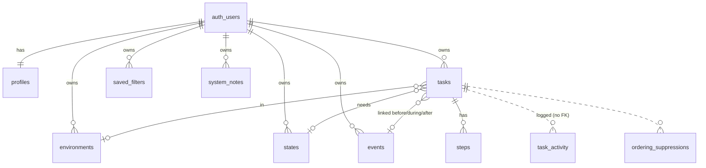

# Horizon: Plan (Run 1b)

Status: **approved and built (Run 2).** This version follows `SPEC.md` revision 2, the answers in `QUESTIONS.md` and the PR review comments. Where they disagreed, `SPEC.md` won, and section 9 lists those cases. Decisions made during the build that this plan didn't settle are in `ASSUMPTIONS.md`.

---

## 1. What I understand we're building

Horizon is a personal to-do app. Each person who signs in has their own private tasks, events and settings. In practice that's you, plus a shared demo account. Its aim is peace of mind rather than productivity.

You put everything you're carrying into it, and give each task three scores from 1 to 5:
- **Effort:** how much it takes out of you
- **Impact:** how much it matters
- **Urgency:** how soon *you* feel it needs doing, whatever the deadline says

Then you stop holding it all in your head. When you open the app, Horizon does the weighing and shows a short, calm list of what's worth your attention now. Each item has a one-line reason. When a task has steps, the **next step is the headline**, because that's the thing you can actually do today.

The core idea is **visibility before priority**. A task only appears when it can be done:
- "Pack for the holiday" appears a few weeks before the holiday, earlier for bigger tasks.
- "Send a holiday photo card" appears only during the holiday.
- "Unpack" appears only after it.

Nothing is lost. The Orbit shows everything: visible, hidden for now, done and let go.

When a moment passes (a deadline goes by, or the holiday ends), Horizon doesn't silently hide or nag. It asks one gentle question about the situation: "Holiday's over. Does this need updating?" If there's no answer for two weeks, Horizon lets the task go itself. It writes a Note saying so, with a one-tap Restore.

**Horizon may act on your behalf, but never silently.** Every automatic change goes into Notes with the reason and an undo.

From the visible list, Horizon ranks tasks in two steps:
1. **How much does each task matter on its own?** This uses urgency, impact, and pressure from any hard deadline. Deadline pressure is scaled by impact. Effort plays no part here.
2. **What's a good order for the list?** A few gentle, switchable adjustments apply:
   - clear small things that have waited a while
   - balance effort against what you've recently been doing
   - start early when deadlines bunch together
   - don't stack heavy tasks back to back

   Overdue tasks and check-ins stay on top.

The tone is UK English and calm: no guilt, streaks or red. You never have to type an exact time: "Sunday, by evening" is enough. Actions are one tap, with no "are you sure?" questions.

Technically, it's a Next.js app on Vercel that talks straight to Supabase with the signed-in user's session. Row Level Security is the privacy boundary. Every schema change is a migration, applied by a GitHub Action only on merge to `main`.

---

## 2. Data model

**Every table is per user.** Each row has `user_id uuid not null default auth.uid()`, which references `auth.users` and is deleted along with that user. Each user only ever sees their own rows (section 3). The **Owner** column below makes this explicit.

All tables have `id uuid primary key default gen_random_uuid()` (unless noted) and `created_at timestamptz not null default now()`. Editable tables also have `updated_at`, which a trigger keeps current. All instants are `timestamptz`, stored in UTC.

**Cross-user safety:** links between tables are **composite foreign keys on `(user_id, id)`**. A task can never point at another user's event, environment or state, even through a hand-crafted request.

| Table | Owner | Purpose | Key columns |
|---|---|---|---|
| `profiles` | per user (PK = `user_id`) | Settings | `timezone` (default `'Australia/Sydney'`), `focus_list_size` (default 10), `show_workings` (default false), `adjustment_flags jsonb` (default `{}`: per-user overrides of the config on/off flags), `notes_seen_at`, `is_demo` (default false) |
| `environments` | per user | Your own list, copied from the presets at sign-up | `name`, `preset_key null` (e.g. `home`, `low_energy`; set on the copied presets, so a renamed preset is still recognised), `hidden_at null` · unique `(user_id, lower(name))` |
| `states` | per user | Same, for states | Same shape as `environments` |
| `events` | per user | Soft anchors | `name`; `starts_at`, `start_precision`, `start_part`; `ends_at null`, `end_precision null`, `end_part null` · check `ends_at >= starts_at` |
| `tasks` | per user | The core item | see below |
| `steps` | per user | Ordered sub-items | `task_id` (on delete cascade), `title`, `position`, `done_at null` |
| `saved_filters` | per user | Views | `name`, `filters jsonb`, e.g. `{ "environment_ids": [], "state_ids": [], "overdue_only": false }` |
| `system_notes` | per user | Notes: what Horizon did and why | `kind`, `local_day date`, `task_ids uuid[]`, `details jsonb`, `resolved_at null` · unique `(user_id, kind, local_day)` |
| `ordering_suppressions` | per user | "Not right? Put it back" for one task's ordering adjustment | `task_id`, `adjustment`, `until` |
| `task_activity` | per user | Append-only history | `id bigint identity`, `task_id` (**no FK**, so it outlives deletes), `kind`, `details jsonb` (title and effort snapshot, before and after values), `occurred_at` |

### `tasks` columns
- `title` (required, trimmed, non-empty)
- `description null`
- `done_when null`, for "Done when…"
- `effort`, `impact`, `urgency`: `smallint`, 1–5, default 3
- `environment_id null`, `state_id null`. A task with none matches every filter.
- **Deadline:** `deadline_at null`, `deadline_precision null`, `deadline_part null`
- **Event link:**
  - `event_id null`, `event_relation null` (`before` / `during` / `after`). Both are set together or both are null.
  - `lead_days null`: your own "appears N days before". Null means the effort-based default.
- **Lifecycle:**
  - `done_at null`
  - `let_go_at null`, `let_go_by null` (`user` / `horizon`). Done and let go can't both be set.
  - `deleted_at null`
- `waiting_since`: set on creation, and reset when the task is undone or restored
- `shaping_hint_dismissed_at null`

### Timing storage (spec §5)
A deadline or event end is stored as the **computed instant** plus how precise you were:
- `precision`: `day`, `part_of_day` or `exact`
- `part`: `morning`, `midday` or `evening`

This answers the review question about `deadline_has_time`. That flag is gone. The instant alone can't tell "end of Sunday" from "Sunday at 23:59 exactly", so `precision` and `part` are what let the UI show "Sun, evening" rather than a fake exact time.

Deadlines and event ends resolve to the **end** of the chosen period:

| Choice | Resolves to |
|---|---|
| On the day | Next local midnight |
| Morning | 12:00 |
| Middle of the day | 17:00 |
| Evening | 22:00 |
| Exact | That time |

Event starts resolve to the **start** of the period:

| Choice | Resolves to |
|---|---|
| On the day | Local midnight |
| Morning | 00:00 |
| Middle of the day | 12:00 |
| Evening | 17:00 |
| Exact | That time |

All boundaries live in config. A single-day event has `ends_at` null.

### Lifecycle status
Status is derived from the timestamps, in this order:
1. `deleted_at` set → **deleted**
2. `done_at` set → **done**
3. `let_go_at` set → **let go**
4. otherwise → **open**

Restoring a deleted task only clears `deleted_at`, so it returns to exactly where it was. Nothing is ever hard-deleted. Horizon never deletes anything.

### Lists
- Environments and states are **per-user copies** of the presets, made at sign-up by a trigger. You can rename, hide or add items (spec §4).
- "Hide" sets `hidden_at`. Tasks keep the label, and it leaves pickers and filters.
- `position` is gone from lists and views. Lists sort presets first, in the brief's order (from `preset_key` and a small order map in config), then your own items A–Z. Views sort A–Z.

### Activity kinds
- **Task:** `created`, `done`, `undone`, `let_go` (`details.by`: `user` / `horizon`), `deleted`, `restored`, `deadline_changed`, `event_link_changed`, `scores_changed`, `edited` (title, description, "Done when…", environment, state)
- **Steps:** `step_added`, `step_done`, `step_undone`, `step_edited`, `step_deleted`, `steps_reordered`

How it's written:
- **Database triggers** on `tasks` and `steps` write the log, so every change is captured. They're `security definer` with a fixed `search_path`. Clients have no write access to it.
- Reordering steps goes through a `reorder_steps(task_id, ids[])` function that writes **one** `steps_reordered` entry, not one entry per row.
- `details` always includes a snapshot of the title and effort. Effort balance (§5) needs to know how heavy finished tasks were.

### Room for later phases, not built now
- **v2 Blocks** adds `blocks` and `block_tasks` tables.
- **v2 Today view** adds a nullable `size` column on `tasks`.
- **v2 "Shaping"** creates blocks and tasks from the existing tables.
- **v3 Roadmap** reads existing events and deadlines. Step timing would add nullable columns to `steps`.
- **Recurring tasks** add a `recurrences` table.
- **"Questions"** add a nullable `kind` column on `tasks`.
- **Graded State matching** adds an ordering column on `states`.
- **Insights** read `task_activity`.



---

## 3. Access rules

**RLS on every table**
- RLS is enabled and forced on every table in `public`.
- Each table has owner-only `select`, `insert`, `update` and `delete` policies using `user_id = (select auth.uid())`, with the same check when writing. They apply to the `authenticated` role only. `anon` gets nothing.
- `task_activity` can only be read. Triggers write it.
- `system_notes` is written only by security-definer functions. You can read a note and mark it resolved.
- `profiles.is_demo` and `user_id` can't be changed by the user (column-level revoke).

**Proof (automated)**
- pgTAP tests in `supabase/tests/` create two users. They check that user B can't read, change, delete or link to any of user A's rows, in every table.
- Another test fails if any `public` table lacks RLS.
- These run in the PR workflow against a throwaway local Supabase, with no secrets (spec §10).
- `SECURITY.md` adds a manual check.

**Auth**
- Magic link uses `signInWithOtp({ shouldCreateUser: false })`, and sign-up is disabled in the dashboard.
- **Try the demo:** a server action signs in as `demo@example.com` with a password read from the server-only `DEMO_PASSWORD` env var. The password is never sent to the browser.
- Email+password must be enabled in Supabase for this. Your own account has no password, so it can still only use the magic link.

**Demo data**
- The sign-up trigger sets `is_demo = true` when the email is `demo@example.com`. A migration also sets it if the account already exists.
- A `seed_demo_data()` SQL function wipes and recreates fake data for the **calling user only**, and only if `is_demo`. It needs no service key.
- Dates are relative to now, so the demo never goes stale.
- It runs when the demo account is empty, and from a "Reset demo" button.

**Keys and data**
- Only the Supabase URL and anon key are used client-side. `service_role` is never used.
- `.env*` is git-ignored, except for a placeholder `.env.example`.
- No third-party calls with task data.

---

## 4. Folder structure

```
src/
  app/
    login/                 magic link + "Try the demo"
    auth/confirm/          magic-link callback
    (app)/                 signed-in layout + nav
      page.tsx             Radar (home) + quick capture + all clear
      look-ahead/          "Time on your hands?" page
      tasks/               Orbit (grouped) · new · [id] editor
      events/              list · new · [id]
      views/
      notes/
      settings/
    error.tsx, not-found.tsx
  components/              TaskCard, ScoreArrows, WhenPicker (day / part / exact), StepList,
                           CheckInPrompt, UndoToast, EmptyState, Workings…
  lib/
    priority/              PURE: no I/O; `now` is always passed in
      config.ts            every weight, threshold, boundary and on/off flag
      time.ts              part-of-day ⇄ instant, tz helpers
      visibility.ts        layer 1 + check-in detection + lead times
      score.ts             layer 2 (returns total + each term)
      order.ts             layer 3 (returns order + every adjustment applied)
      reasons.ts           "why it's here" key
      conflicts.ts         deadline-vs-visibility warning
      housekeeping.ts      which tasks are due an automatic let-go
      notes.ts             which notes the current ordering should write
      __tests__/
    copy/en-GB.ts          every user-facing label (Radar, Orbit, Notes, reasons, prompts)
    supabase/              browser + server clients (@supabase/ssr)
    data/                  typed queries + server actions
    validation.ts          zod schemas
  middleware.ts
supabase/
  config.toml
  migrations/              schema, RLS, triggers, functions
  tests/                   pgTAP: RLS + triggers
  seed.sql                 local dev only (calls the same fake dataset)
.github/workflows/
  ci.yml                   PRs: typecheck, lint, Vitest, build, pgTAP on local Supabase. No secrets.
  migrate.yml              push to main only: supabase link + db push
README.md  SECURITY.md  DEPLOY.md  ASSUMPTIONS.md  .env.example
```

**Libraries:**
- Next.js App Router, TypeScript in strict mode
- `@supabase/ssr`
- Tailwind (follows the device's light or dark mode)
- Vitest, zod
- date-fns with `@date-fns/tz`

DB types are generated from the migrations.

**Where logic runs:** the Radar is a server component.
1. It loads open tasks, their events, recent `done` activity and the profile.
2. It merges `config.ts` with the profile's on/off overrides.
3. It calls the pure functions with `now`.

Mutations are server actions that use your own session, so RLS always applies.

---

## 5. Priority model

Every number below is in `config.ts`. The functions take `(input, now, config)` and nothing else, so they're deterministic and testable. `n(x) = (x − 1) / 4` maps a 1–5 score to 0–1.

### Layer 1: visibility and check-ins

`visibility(task, event, now, tz, config)` returns one of:
- `visible`
- `hidden` (with a reason and the "appears on" date)
- `check_in` (with which moment passed and when)

Done, let go and deleted tasks are never on the Radar.

| Link | Visible window | Check-in when |
|---|---|---|
| none | always | — |
| `before` | from `starts_at − lead` until `starts_at` | the event has started |
| `during`, a range | `starts_at` … `ends_at` | the event has ended |
| `during`, single day | that whole local day | the day is over |
| `after`, a range | from `ends_at` | — |
| `after`, single day | from `starts_at` | — |

**Lead time:** `lead_days`, if you set it. Otherwise effort 1–2 → 7 days, 3 → 14 days, 4–5 → 21 days.

**Deadline:** a passed deadline is always a check-in (overdue), even when the event window has also closed.

**Check-ins**
- A check-in task is **shown, at the top**, with a prompt about the situation, offering Update, Done or Let go.
- Its clock starts at the moment that passed: the deadline, the event start for `before`, or the event end for `during`.
- **Update** clears the check-in naturally, by moving the deadline or event, unlinking it, or removing the deadline.
- **Auto let-go:** after `CHECK_IN_GRACE = 14` days with no change, the task is let go by Horizon.

**How auto let-go runs.** With no backend server, it runs **when you open the app**.
- An RPC, running as you, lets go every task whose grace period has passed.
- It records `let_go_by = 'horizon'` and the timestamp of the grace end, not the time you opened the app.
- It writes or extends that day's Note.
- This means the let-go only happens once you next visit. That's when you'd see it anyway.

**Conflict warning:** shown on save if the deadline falls before the moment the task can first appear. It doesn't block the save.

### Layer 2: priority score

Effort is **not** in this layer.

```
importance    = W_URGENCY · n(urgency) + W_IMPACT · n(impact)
impactScaling = IMPACT_FLOOR + (1 − IMPACT_FLOOR) · n(impact)
deadlinePress = W_DEADLINE · curve(daysLeft, DEADLINE_HORIZON) · impactScaling
                  where curve = 1 if overdue, else clamp(1 − daysLeft / horizon, 0, 1) ^ 2
eventPress    = W_EVENT · curve(daysToStart, EVENT_HORIZON) · impactScaling
                  (`before` links only, and only when there's NO deadline: the deadline wins)
score         = importance + deadlinePress + eventPress
```

| Weight | Value | Why |
|---|---|---|
| `W_URGENCY` | 45 | Your own judgement leads |
| `W_IMPACT` | 35 | |
| `W_DEADLINE` | 60 | Can dominate when impact is high and the date is close |
| `DEADLINE_HORIZON` | 14 days | Further-off deadlines add nothing (tax isn't driven by April) |
| `IMPACT_FLOOR` | 0.4 | A low-impact deadline gets 40% of the push: a nudge |
| `W_EVENT` | 15 | A gentle warm-up before an event, never "overdue" |
| `EVENT_HORIZON` | 7 days | |

**The spec's examples** (effort as confirmed: 1, 4, 1):

| Example | Score |
|---|---|
| Toilet paper (U5, I2, no deadline) | 45 + 8.75 = **53.8**, high |
| Tax return (U4, I4, deadline in ~120 days) | 33.75 + 26.25 + 0 = **60.0**, high |
| Zoo (U1, I1), deadline 10 days away | 60 · 0.08 · 0.4 = **2.0** |
| Zoo, deadline tomorrow | 60 · 0.86 · 0.4 = **20.7** |
| Zoo, by Wednesday evening, on Wednesday | about **24**, moderate |
| Same as zoo but I5, deadline tomorrow | 35 + 51.7 = **86.7**, pushes hard |

An ordinary U2/I2 task scores 20. So the zoo tickets climb from the bottom to mid-list as Wednesday nears.

The tests assert relationships, not exact numbers:
- toilet paper and tax both score ≥ 50
- zoo rises as Wednesday nears, but stays below both
- zoo's deadline gain is less than half that of the I5 version
- **the score is identical for E1 and E5**

### Layer 3: ordering

`orderTasks(items, recentDone, filters, suppressions, now, tz, config)` returns, for each task:
- the score, adjusted score, reason key and the adjustments applied (for "show workings")
- note candidates

Each step below has its own on/off flag.

1. **Score** every visible or check-in task that passes the filters. Ordering only looks at the filtered list.

2. **Quick-win bump** (`quickWin`)
   - Applies when effort ≤ 2 and impact ≤ 2, and the task has been visible and waiting for at least 7 days. The wait starts at the later of `waiting_since` and the first moment it became visible.
   - It adds +8, rising linearly to +20 at 21 days.
   - Reason: "Been waiting a while: quick win".

3. **Effort balance** (`effortBalance`). "Recent" means `done` activity in the last `BALANCE_WINDOW = 3` days, using each task's effort snapshot. These rules need at least `BALANCE_MIN_DONE = 3` completions in that window.
   - **After a heavy run:** if at least 2/3 of recent completions had effort ≥ 4, tasks with effort ≤ 2 get +10. Reason: "Something lighter after a heavy run".
   - **After a light run:** if at least 2/3 of recent completions had effort ≤ 2, heavy tasks (effort ≥ 4) that have waited 7 days or more get +10. Reason: "You've cleared lots of small things: maybe time for a bigger one?"
   - **Low energy:** this one doesn't need recent completions. When the State filter includes the "Low energy" preset (matched by `preset_key`, so renaming it doesn't break this), each task gets `+4 · (5 − effort)`, so effort 1 gets +16 and effort 5 gets 0. Reason: "Lighter, for a low-energy moment".

4. **Spread deadline clusters** (`spreadClusters`). There's **no daily capacity.**
   - **Finding a cluster:** take not-overdue tasks with deadlines in the next 14 days. A cluster is any group whose deadlines lie within 3 days of each other, with at least `CLUSTER_MIN_TASKS = 3` tasks.
   - **How much each task weighs:** `load = effort + 0.5 · open steps`. Steps are the rough "how much stuff" signal, and you're never asked for time estimates.
   - **Who moves:** rank the cluster heaviest first. Task r of n (r = 0 is the heaviest) gets an effective deadline `min(MAX_SHIFT = 5, 1 · (n − 1 − r) · load / averageLoad)` days earlier. The lightest task doesn't move.
   - The task is then re-scored with the layer 2 function, using that effective deadline.
   - The more tasks bunch up, and the heavier the task, the earlier it starts.
   - Reason: "Brought forward: busy week ahead".

5. **Sort**
   - **Check-in tasks first.** Overdue ones come before passed-event ones, and each group is sorted by adjusted score.
   - Then everything else by adjusted score.
   - Ties go to the earlier deadline, then the older task.

6. **Mix effort** (`mixEffort`)
   - Scan the first 2 × list size non-check-in positions.
   - If more than one heavy task (effort ≥ 4) would sit in a row, pull forward the nearest lighter task (effort ≤ 3) from within the next 3 positions.
   - It only moves if its score is within 15 points, so a much more important heavy task is never displaced.
   - Reason: "Something lighter between bigger tasks".

**Ordering suppressions:** if you tap "Not right? Put it back" on an ordering Note, that adjustment is skipped for that task for 7 days (Q-R2-2).

**Tests:** each adjustment gets a fires and a doesn't-fire case, plus:
- its on/off flag
- check-ins staying on top
- the score-gap guard
- stable ordering

### "Why it's here" (one line, text in `copy/en-GB.ts`)

The first match in this order wins:
1. Check-in prompt (it *is* the line), e.g. "Sunday's been and gone. Still need this?"
2. Brought forward
3. After a light run
4. After a heavy run, or low energy
5. Quick win
6. Lighter between bigger tasks
7. "Due Wed" / "Due today, by evening", when deadline pressure is the largest term and the deadline is within 7 days
8. "Before Holiday"
9. "While Holiday is on"
10. "Urgent" (U ≥ 4)
11. "Matters a lot" (I ≥ 4)
12. "Ready when you are"

**Show workings** (Settings): each Radar card lists the importance, deadline and event terms, every adjustment with its points, and the effective deadline if a task was brought forward.

### Notes written by Horizon

At most **one note per kind per local day**. Repeats on the same day add task ids to that day's note.

| Kind | Written when | Action |
|---|---|---|
| `auto_let_go` | Housekeeping lets a task go | Restore |
| `hidden_by_event` | Your edit to an event or link hides a task that was visible (Q-R2-1) | Edit |
| `brought_forward`, `light_run_boost`, `heavy_run_boost`, `quick_win` | The Radar applies that adjustment to a task in the visible list for the first time that day | Put it back (suppress) |
| `deleted` | You delete a task | Restore |

- `mixEffort` and `low energy` don't write notes. They're small, and visible in the reason line.
- No counts or badges. Nav shows a subtle dot when there are notes since `notes_seen_at`.

### Visibility test list (definition of done)
- each link type, inside and outside its window, for single-day and range events
- lead times for effort 1–2, 3 and 4–5, and a user override
- the birthday-card example:
  - hidden before the holiday
  - visible during it, with urgency from "Sunday by evening"
  - after the holiday ends, the check-in prompt "Holiday's over"
  - after Sunday, overdue
- a `before` task becoming a check-in at the event start
- auto let-go at 14 days, but not at 13
- the conflict warning
- part-of-day → instant conversions, including Sydney DST changeover days
- a done, let-go or deleted task is never visible

---

## 6. Screens

- **Login:**
  - an email field for the magic link
  - a "Try the demo" button
- **Radar:**
  - quick capture at the top: a title, with 3/3/3 arrows to adjust
  - 10 cards with a calm "Show more" that reveals 10 more at a time
  - card headline: the next open step, with the task title as the subheading (title only if no steps)
  - the reason line, inline check-in prompts, done and step-done buttons, and arrows for effort, impact and urgency
  - filter chips and a View picker
  - when nothing's showing: the all-clear message and a subtle "Time on your hands? Look ahead" link to a page with:
    1. review Notes
    2. add events
    3. create Views
    4. Blocks, shown as "coming later", or hidden (Q-R2-4)
- **Task editor:**
  - all task fields, with part-of-day pickers ("more options" holds the exact time)
  - the event link, with info like "Appears 21 days before Holiday, because it's a big one. Sounds off? Set your own number of days."
  - the conflict warning
  - the dismissible shaping hint
  - Done, Let go and Delete. Delete has no confirmation; it shows an Undo toast and writes a Note with Restore.
- **Events:**
  - a list, plus create and edit
  - "On a day", or "Between dates", with optional part or time under "more options"
  - Delete with linked tasks offers "Unlink tasks" or "Cancel". Events are hard-deleted; they have no lifecycle.
- **Orbit:**
  - grouped as Visible, Hidden for now (with the reason), Done and Let go
  - undo and restore
  - inline score arrows
- **Notes:** the list described in §5, with actions.
- **Settings:**
  - environments and states: rename, hide, add
  - timezone
  - Radar size
  - "Show workings"
  - layer 3 toggles
  - "Reset demo", for the demo account only
- **All screens:**
  - friendly empty states
  - inline validation
  - error boundaries with no stack traces
  - mobile-first
  - light and dark mode from the device setting

---

## 7. Migration pipeline

- **`migrate.yml`**
  - Runs only on `push` to `main`.
  - `concurrency: migrate`, `permissions: contents: read`.
  - Uses a pinned `supabase/setup-cli`, then runs `supabase link --project-ref "$SUPABASE_PROJECT_ID"` and `supabase db push`.
  - Secrets come in only through `env:`, and nothing is echoed.
- **`ci.yml`**
  - Runs on pull requests, with no secrets.
  - Typecheck, lint, Vitest and `next build`.
  - `supabase start` and `supabase test db` for the pgTAP RLS and trigger tests.
- Migrations are never edited once merged.
- Vercel previews point at the production database, so a PR that changes the schema may break its preview until merge. `DEPLOY.md` documents this.
- Vercel region: `syd1`.

---

## 8. Build order (Run 2)

Small commits on this branch, so PR [AE-CuriousSolver/Horizon#1](https://github.com/AE-CuriousSolver/Horizon/pull/1) updates.

1. **Scaffold:** Next.js, TypeScript, Tailwind, Vitest, ESLint, `.gitignore`, `.env.example`, `supabase init`, and the labels file.
2. **Pure logic, test-first:**
   - part-of-day time helpers
   - visibility and check-ins
   - score
   - ordering
   - reasons, conflicts, housekeeping and note candidates
3. **Migrations:**
   - tables and constraints
   - RLS
   - triggers: `updated_at`, activity log, new-user presets and profile, demo flag, event unlink
   - RPCs: `reorder_steps`, `run_housekeeping`, `seed_demo_data`, note upsert
   - pgTAP tests
   - generated types
4. **Workflows:** `ci.yml` and `migrate.yml`.
5. **Auth:** SSR clients, middleware, magic link, Try the demo, sign-out.
6. **Data layer:** queries, server actions and validation.
7. **Screens:**
   - Radar, with quick capture, check-ins and all clear
   - Task editor
   - Events
   - Orbit
   - Notes
   - Views
   - Settings and Look ahead
   - then a pass for empty states, errors, phone width and dark mode
8. **Demo dataset and "Reset demo".**
9. **Docs:** README, SECURITY, DEPLOY and ASSUMPTIONS.
10. **Final pass:** a clean build, all tests green, a check against the definition of done, and a PR description update.

---

## 9. Conflicts resolved (SPEC.md wins) and scope flags

**Conflicts, resolved in favour of the brief:**

1. **Environments and States.**
   - Your PR comment said "preset for v1, personalised in v2".
   - Revision 2 (§4, §8 Settings, written afterwards) says each user gets their own copies they can rename, hide and add to.
   - **Planned per the brief.** If you'd still rather have presets only in v1, say so: it removes the Settings list editor and the `hidden_at` handling, which is a small saving.
2. **Q-T1 answer:** you said "mark as deleted after a set time". The brief says **let go**, and that Horizon never deletes. Planned as let go.
3. **Q-P4:** the default asked a question after the last step. The brief says no prompt. Planned with no prompt.
4. **Q-P5 ("let it go" = mark done):** replaced by the separate **Let go** lifecycle state.
5. **Q-P7 (cap 5):** the brief says 10, editable.
6. **Q-S5 (daily capacity 6):** dropped. Cluster spreading uses task count, effort and open steps only.
7. **Q-T5 (`all_day` toggle):** dropped. Events are "on a day" or "between dates", stored with precision.
8. **Run 1 "ease" term:** removed. Effort is neutral in layer 2.
9. **Task deletion:** Run 1 had a confirmation and a hard delete. Now it's a soft delete with Undo and a Note, and no confirmation.

**Brief vs brief:**

10. **"Hidden by events" Note vs check-ins.** §7's example, "*Pack for holiday* was hidden because Holiday has started", conflicts with §5. Under §5, a `before` task whose event has started **stays visible** with a check-in. My interpretation is in Q-R2-1.

**Scope flags (not too big, but worth knowing):**
- **Auto let-go runs when you next open the app,** not on a timer. Spec §2 says there's no backend server. A scheduled job (`pg_cron`) is possible later if you want it to happen while you're away.
- **"Undo" on ordering Notes** needs a small suppression table (§2). It's the one piece of v1 I'd cut first if time is short. The fallback is a link to the matching Settings toggle.
- **Part-of-day pickers for events with ranges** are the largest UI piece in v1. I'll keep the first version simple: a date, an optional end date, and "more options".
- **Nothing is too big for v1.** The rest of revision 2 fits the plan without restructuring.
