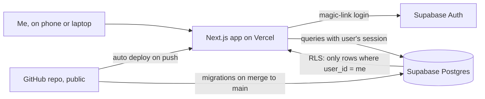

# Horizon — Product Brief (v1, revision 2)

> **Purpose of this repo.** This project shows product definition and the ability to hand work to an AI agent. The product vision, requirements and decisions are mine (Anna-Marie Edeleanu). The implementation is delegated to an AI coding agent (Claude Code), and I review it against this brief. This file is the brief the agent works from.
>
> **Revision 2** adds a task lifecycle (done / let go / delete), Horizon notes, part-of-day timing, next-step-first display, quick capture, effort balance, and testing tools. It also moves the Today view and project guidance into v2. **If this brief conflicts with an answer in `QUESTIONS.md`, this brief wins.**

---

## 1. Vision

A calm, personal "things to do" app that helps you **focus on what's in front of you now**, and trust that everything further down the road is held safely out of sight.

People are good at noticing what's in the way of a task (deadlines, where they need to be, how they feel). But weighing all of those factors together to decide *what to do next* is draining. Horizon does that weighing and shows a short ordered list.

### Why "Horizon"
Horizon is about presence, not output or being "prepared for everything". You only see as far as the horizon: the present and near future. What comes later is real and accounted for, but it isn't in view until it's relevant. Zooming out shows the road ahead, but the default is what's in front of you.

### Metaphor and naming
- **Horizon** (fixed name): the product, and the limit of what's in view right now.
- **Roadmap** (fixed name): the zoomed-out timeline of what's further down the road (v3).
- **Placeholder names, likely to change:** *Orbit* is all the tasks you're carrying. *Radar* is the tasks surfaced as worth your attention now. *Views* are saved filters, *Blocks* are curated groups (v2), and *Notes* is what Horizon did and why.

Placeholder names must be easy to rename. Keep all user-facing labels in a single labels file, and use neutral names in code and the database (e.g. `tasks`, `saved_filters`, `system_notes`), not the metaphor words.

### Tone
Encouraging and non-demanding. It's about peace of mind and lower cognitive load, not productivity or efficiency. No guilt language, red alarms or streaks. UK English.

### Principles
- Keep it simple, and let the list change as things change.
- Limit what's visible, but reassure the user that nothing is lost or forgotten.
- A task only appears when it can actually be done.
- **Never force precision.** Don't make people type exact times. Rough is the default, and specific is optional.
- **Don't make people explain themselves.** Actions are one tap. No "are you sure?" follow-ups except for permanent deletion.
- **Horizon may act on the user's behalf, but never silently.** Every automatic change is recorded in Notes with the reason and a way to undo it.

---

## 2. Stack (decided)

| Part | Choice | Notes |
|---|---|---|
| App | Next.js (App Router) + TypeScript | Deployed on Vercel (Hobby plan, personal use) |
| Database | Supabase Postgres | Region: Sydney (`ap-southeast-2`) |
| Auth | Supabase Auth, email magic link | **Public sign-up disabled** |
| Access control | Postgres Row Level Security (RLS) on every table | Each row has a `user_id`, and users can only read/write their own rows |
| Styling | Agent's choice (e.g. Tailwind) | Mobile-first, works well on a phone |
| Tests | Agent's choice (e.g. Vitest) | Required for scoring, ordering and visibility logic |
| Migrations | Supabase CLI migrations in `supabase/migrations/`, applied by a GitHub Action | Runs only on merge to `main`. See section 10 |

There's no separate backend server. The app talks to Supabase directly, and RLS enforces privacy.

---

## 3. Users and accounts

- **Me:** the only real user. I'm created manually in the Supabase dashboard.
- **Demo account:** loaded with fake seed data so others can try the app. Its email is the fake address `demo@example.com`, which can be public in the repo. The password is never committed.
- There's no public sign-up page, so the login screen only signs in existing accounts.

---

## 4. Core concepts

### Task
A task is **something you can finish**. It has:
- `title`, optional `description`
- an optional **"Done when…"** line (e.g. "CV sent to 3 roles"). This gently encourages a clear finish without forcing one.
- **Scores (1–5):**
  - **Effort:** how much it takes out of you (a neutral measure, not "ease")
  - **Impact:** how much it matters
  - **Urgency:** how soon *you* feel it needs doing, independent of any deadline
- **Environment** (optional, one) and **State** (optional, one). A task with none set matches every filter.
- **Optional deadline** (section 5)
- **Optional event link** with a relation: `before`, `during` or `after` (section 5)
- A **lifecycle status** (section 7)

### Step
- Belongs to a task. Has a `title`, `order` and `done` flag.
- **When a task has open steps, the next open step is the headline on the Radar, and the task title is the subheading.** You might do one step every couple of days, so the step is the actionable thing, and the overall task is context.
- Marking the last step done does **not** complete the task and does **not** prompt. The user marks the task done when they choose.
- In v1, steps inherit the task's timing.

### Event
- `name`, a day (or a range of days), and optional timing (section 5).
- Events are fluid anchors, not hard limits (e.g. "UK holiday", "Dinner with John").

### Environment and State lists (per user)
- **Each user has their own lists.** On sign-up, each user gets their own copies of the presets, as rows they own. They can rename or hide any of them (including presets) and add their own.
- **Environment presets:** Home, Computer, Errands, Office, Open hours, **Privacy** (on your own: where you can make a private call, work on something sensitive or a surprise, or simply do it more easily without others around).
- **State presets:** Focused, Productive, Social, Low energy.
- Hiding an item keeps the label on existing tasks, but removes it from pickers and filters.

---

## 5. Timing

### Part-of-day, not exact times
Typing exact times is annoying and feels like a calendar. Horizon uses **rough parts of the day by default**, and exact times are optional.

| Option | Meaning |
|---|---|
| **On the day** (default) | Any time that day |
| **Morning** | Until 12:00 |
| **Middle of the day** | 12:00 to 17:00 |
| **Evening** | 17:00 to 22:00 |
| **Specific time** | Optional, tucked under "more options" |

- **Deadlines:** a date plus a part of the day, read as "by". For example, "Sunday, by evening" is due at the end of Sunday evening.
- **Events:** a day, or a range of days ("between dates"). Each end can optionally have a part of the day or a specific time, hidden under "more options". Don't use the phrase "all day"; an event is simply "on" a day.
- **Storage:** save the computed instant (UTC) plus the precision used (`day`, `part_of_day` or `exact`), so the UI shows what the user chose ("Sun, evening"), not a fake precise time. The part-of-day boundaries live in config.
- Display everything in the user's timezone (default `Australia/Sydney`, editable in Settings).

### Visibility rules (layer 1)
A **deadline** is fixed and hard. An **event** is a soft anchor with room for judgement. A task can have either, both or neither.

| Setup | Visible on Radar | How urgency behaves |
|---|---|---|
| Deadline only | Always | Increases as the deadline nears; overdue is highest |
| Event `before` | From **N days before** the event until it starts (see below) | Increases gently as the event nears. It's soft and never marked "overdue" because of an event |
| Event `during` | Only while the event is on (a single-day event → that day) | Normal scoring while visible |
| Event `after` | Once the event has ended (or started, if it's a single day) | Normal scoring once visible |
| Event + deadline | Visibility follows the event rule | Urgency follows the deadline. **The deadline always wins as the hard limit** |

**`before` lead time is set by effort**, so big preparation shows up earlier:
- Effort 1–2: 7 days before
- Effort 3: 14 days before
- Effort 4–5: 21 days before

All three values live in config. The task editor shows a small info note, "Appears 21 days before Holiday, because it's a big one", with "Sounds off? Set your own number of days". A user-set value overrides the effort default.

**Example:** "Send birthday card", linked `during` "Holiday" (so there's a holiday photo), deadline Sunday by evening (so it arrives by Wednesday). It's hidden until the holiday starts. Once visible, urgency is driven by Sunday.

**Conflicts:** if a deadline falls before the point where the task can become visible, show a gentle warning when saving. Don't block the save.

### When time runs out
Two situations need a check-in rather than silently showing or hiding the task:
1. **The deadline has passed** (overdue), including when the event window has also closed.
2. **The event moment has passed** for a `before` task (the event started), or for a `during` task (the event ended), and it isn't done.

In both cases, the task **stays visible** with a gentle prompt about the *situation*, not the task. For example, "Holiday's over. Does this need updating?" or "Sunday's been and gone. Still need this?". The prompt offers:
- **Update:** change the deadline or event link
- **Done**
- **Let go**

If there's **no response after a set time** (default 14 days, in config), Horizon lets the task go itself and records it in Notes (section 7).

---

## 6. Prioritisation model

Three separate layers decide what the user sees and in what order:

| Layer | Question it answers | Driven by |
|---|---|---|
| 1. Visibility | *Can* this be done now? | Event links and lead times (section 5) |
| 2. Priority score | How much does this task matter, on its own? | Impact, urgency, deadline pressure |
| 3. Ordering | Given everything visible, and what's been happening, what's a good sequence? | Priority score + list-level adjustments |

### Layer 2: priority score (per task)

**Urgency and deadline are different things:**
- **Urgency** (user-set) is how soon *I* feel it needs doing. Many urgent things have no deadline.
- **Deadline pressure** (computed) rises as a hard deadline approaches. **It's scaled by impact**: a deadline on something that matters pushes hard, while one with a small consequence only nudges.

**Effort doesn't change a task's importance.** Effort is neutral in layer 2. It only affects *ordering*, in layer 3. High-effort, high-impact tasks must rank well, because getting them done is a big relief, and the app shouldn't encourage avoiding hard things.

| Example | Urgency | Deadline | Impact | Effort | Result |
|---|---|---|---|---|---|
| Buy toilet paper | 5 | none | 2 | 1 | High, driven by urgency |
| Submit tax return (owed money) | 4 | in 4 months | 4 | 4 | High now, driven by urgency, not the far deadline |
| Book zoo tickets online (30% off) | 1 | Wednesday | 1 | 1 | Moderate near Wednesday, only a nudge because impact is low |

### Layer 3: ordering (across the visible, filtered list)

Start from the priority score, then apply gentle, explainable adjustments. **Each adjustment has an on/off flag in config.**

- **Quick-win bump:** a low-effort, low-impact task that has been visible and waiting a while gets bumped up, so it can just be cleared.
- **Effort balance** (replaces the earlier "ease" term), based on what's actually been happening:
  - *After a run of heavy tasks* (recently completed tasks were mostly high effort), lighter tasks get a boost, to give some breathing room.
  - *After a run of light wins* (recent completions were mostly low effort while a heavy task has been sitting there), the heavy task gets a boost: "you've been clearing small things, maybe time for a bigger one?"
  - *When the active State filter is "Low energy"*, lighter tasks get a boost.

  The window for "recent" comes from the activity history (e.g. the last 3 days) and lives in config.
- **Spread deadline clusters:** when several tasks have deadlines close together, bring some of them forward so there isn't a pile-up just before. Use the number of tasks and their effort to decide how far, but **don't** assume a daily workload capacity. Free time varies too much from day to day (a working day versus a Sunday).
- **Mix effort:** avoid several high-effort tasks back to back at the top of the list. Interleave lighter ones, but never displace a much more important heavy task.
- **Overdue and check-in tasks** (section 5) stay at the top.

### Requirements
- The agent proposes the exact formulas and weights in `PLAN.md`, based on the intent above.
- Layer 2 and layer 3 each live in **pure functions**, with all weights, thresholds and on/off flags in one config object.
- Unit tests cover the three examples above, plus a fires and doesn't-fire case for each layer 3 adjustment. Tests assert relationships, not exact numbers.
- Each task shows a short, single **"why it's here" line** (e.g. "Urgent", "Due Wed", "Been waiting a while: quick win", "Brought forward: busy week ahead", "Something lighter after a heavy run").
- **"Show workings" switch** (Settings, off by default): when on, each Radar task shows every term of its score and every adjustment applied. This is for testing and tuning.
- The README explains the model in plain language.

### Activity history
Record an append-only log of task events: created, completed, undone, let go (by user or by Horizon), deleted, restored, deadline changed, event link changed, scores changed, edited, and steps added, completed, undone and deleted, with timestamps and a title snapshot. Layer 3 reads it for effort balance and "been waiting a while". **v1 doesn't analyse it any further.**

---

## 7. Task lifecycle and Horizon notes

### Lifecycle
A task ends in one of three ways. **All three keep the row in the database** (soft states, using timestamps), so history and future pattern-spotting work, and anything can be undone.

| Outcome | Meaning | Who | Where it goes |
|---|---|---|---|
| **Done** | Completed | User | Orbit → Done list. Can be undone. |
| **Let go** | Can no longer be done, or its moment has passed (deadline long gone, event over) | User, or Horizon automatically after a check-in gets no response (section 5) | Orbit → Let go list. Can be restored. |
| **Deleted** | No longer needed, or added by mistake | User only | Hidden everywhere. A short "Undo" option appears straight after deleting, and the Notes entry offers Restore. |

Horizon never deletes. It only lets go, and always writes a Note when it does.

### Notes (placeholder name): what Horizon did and why
A calm, user-facing log of the decisions Horizon made on the user's behalf, so it reduces thinking without hiding anything. Each note has a plain-language reason and an action:
- **Lifecycle:** "Sunday passed two weeks ago and we didn't hear back, so we let *Send birthday card* go. Not right? **Restore**"
- **Hidden by events:** "*Pack for holiday* was hidden because Holiday has started. Not right? **Edit**"
- **Big-picture ordering:** "*Tax return* has been sitting a while and you've cleared lots of small things, so we've moved it up." Or: "A run of deadlines is coming, so we've brought a few forward."

Rules:
- At most one note per adjustment type per day, so it never feels spammy.
- No unread counts or badges. At most a subtle dot.
- Reached from the main navigation and from the "all clear" screen (section 8).

---

## 8. Screens (v1)

1. **Login:** magic link. Plus a "Try the demo" button that signs in to the demo account (the demo password lives only in a server-side env var).
2. **Radar** *(placeholder name)*, the home screen:
   - An ordered list of visible tasks, highest priority first. It shows **10 by default** (editable in Settings), with a calm "show more".
   - **Display:** the next open step as the headline, with the task title as the subheading. A task with no steps shows its title only.
   - The "why it's here" line.
   - Quick actions: mark done, mark the next step done, and adjust effort, impact and urgency inline with up/down arrows.
   - Check-in prompts (section 5) appear inline on the relevant tasks.
   - Filters: environment, state (exact match, multi-select), overdue only. Plus a View picker.
   - **Quick capture** at the top: type a title and save. The default scores (3 / 3 / 3) are shown with up/down arrows to change them if wanted. There's no environment, state, deadline or event, and those can be added later.
   - **All clear:** when nothing's showing, a short calm message ("Nothing needs you right now. Everything else is held safely."), with no celebration. Below it, a subtle, non-obvious link ("Time on your hands? Look ahead") leads to:
     1. a review of Notes (score changes, tasks let go: all good?)
     2. add events
     3. create Views
     4. (v2) organise Blocks
3. **Views:** save the current filters as a named View, then rename, delete or apply it.
4. **Task editor:** title, description, "Done when…", steps (add, reorder, tick), scores, environment, state, deadline (part-of-day picker), event link with relation and lead-time info, a conflict warning, and done, let go and delete actions.
   - **Gentle shaping hint:** when a task has no steps and high effort (or no "Done when…"), show a soft, dismissible hint: "Big one? You could break it into steps, or say what done looks like."
5. **Events:** list, create, edit and delete events, using the day / range / part-of-day pickers. Deleting an event with linked tasks asks: unlink the tasks (they keep any deadline) or cancel.
6. **Orbit:** every task, grouped as Visible, Hidden for now (with the reason, e.g. "Appears 21 days before Holiday"), Done and Let go. Tasks can be restored or undone from here.
7. **Notes:** section 7.
8. **Settings:**
   - edit or hide environments and states
   - timezone
   - Radar list size
   - "show workings" switch
   - layer 3 adjustment toggles (for testing)

---

## 9. Requirements and edge cases

- **Privacy:** RLS is enabled on every table. A user can never read or write another user's rows, and automated tests prove it.
- **No secrets in the repo.** `.env*` goes in `.gitignore`. Only the Supabase URL and anon (public) key are used client-side. The `service_role` key is never used in the app or committed.
- **No real data in the repo.** Seed data is fake only.
- Empty states are friendly.
- Validation: the title is required, scores must be 1–5, and an event's end can't be before its start.
- Errors: user-friendly messages with no stack traces in the UI, and the app doesn't crash on network failure.
- Scale: one user with hundreds of tasks. No need to optimise further.
- No AI or third-party calls with task data.
- Light and dark mode follow the device setting.

---

## 10. Migrations

- **All schema changes go through migrations.** Every table, column, index, RLS policy, trigger and function is a timestamped SQL file in `supabase/migrations/`. Never ask me to run SQL by hand or edit tables in the dashboard. Never edit a migration that has already been merged; add a new one instead.
- **Migration pipeline:** a GitHub Actions workflow runs `supabase db push` **only on push to `main`** (i.e. when I merge a PR). It uses repo secrets `SUPABASE_ACCESS_TOKEN`, `SUPABASE_DB_PASSWORD` and `SUPABASE_PROJECT_ID`. The workflow must never print secrets or run on other branches or on pull requests. The agent never has database credentials.
- A separate CI workflow on pull requests, with **no secrets**, may run tests, including database tests against a throwaway local Supabase.

---

## 11. Out of scope for v1 (future phases)

Design the data model so these can be added without a rewrite, but **don't build them**.

### v2: Blocks, Today, and shaping projects
- **Blocks:** groups of tasks the user curates (e.g. Admin, Holiday, Finances, Job related). Blocks are what people might otherwise call "projects", but Horizon doesn't track progress or outcomes. A block can be assigned to a day and part of the day. Starting a block shows only its tasks.
- **Today view** (for today or tomorrow): based on **availability**, not environment or state. The user describes their day, e.g. "a couple of 1-hour gaps", "3 hours this morning and that's it" or "two 30-minute commutes and an hour before the kids get home", plus the mix of environments and states they'll be in. Horizon suggests what could realistically be ticked off in that time, based on the ranking. The goal here is completion. Elsewhere in Horizon, time stays fluid and tasks never get time limits.
  - *Open question for v2:* effort isn't duration (a hard phone call is high effort but takes 5 minutes). The Today view will probably need an optional rough size per task (e.g. quick / short / medium / long). Decide in v2.
- **Shaping projects into tasks:** a gentle guided flow for task lists that feel endless ("Do these tasks feel like they go on and on?"). It asks: what are you trying to achieve (that becomes the block name)? What would you like to tick off? What would you like to know? What do you need to look into? The answers become concrete tasks inside a block. For example, "Apply for jobs" becomes a *Job related* block containing "Refresh CV and LinkedIn", "Research the job market", "Search Seek" and "Set up job alerts".

### v3: Roadmap
A zoomable timeline of what's coming up (tomorrow → next month → next year), showing events, deadlines and blocks. Possibly step-level timing.

### Later
- Pattern insights and gentle prompts from the activity history: tasks left undone for a long time while doable, tasks added and removed quickly, deadlines that keep moving, and what tends to get ticked off.
- Recurring tasks
- "Questions" as a task type
- Graded State matching
- Calendar integration

---

## 12. Definition of done (v1)

- [ ] I can log in by magic link. Public sign-up is off. Visitors can use "Try the demo".
- [ ] I can quick-capture a task from a title alone.
- [ ] I can create, edit, complete, undo, let go, restore and delete tasks, with steps, scores, "Done when…", environment, state, deadline and event link.
- [ ] Deadlines and events use the part-of-day pickers. Exact times are optional and hidden by default.
- [ ] I can create, edit and delete events, including date ranges.
- [ ] The Radar shows a ranked list of 10 (editable) that follows the visibility rules and effort-based lead times. It shows next-step-first, has filters and saved Views, and has inline score arrows.
- [ ] Check-in prompts appear for passed deadlines and events. Unanswered ones are let go automatically after the configured time, and a Note is written.
- [ ] Notes shows automatic let-gos, hidden-by-event explanations and big-picture ordering notes, each with an undo or edit action.
- [ ] The "show workings" switch and the layer 3 toggles work.
- [ ] Unit tests cover every visibility rule (including the birthday-card example and the lead times), the part-of-day conversions, the three score examples, and each layer 3 adjustment, and they pass.
- [ ] Activity history is recorded for every task change.
- [ ] RLS is on for every table, and automated tests prove one user can't see another's data. `SECURITY.md` explains how to check this manually.
- [ ] The whole schema is in `supabase/migrations/`, and the GitHub Action applies it on merge to `main`.
- [ ] The demo account has fake data and a "Reset demo" option.
- [ ] `README.md` explains the project purpose, the prioritisation model and the screens.
- [ ] `DEPLOY.md` gives step-by-step one-time setup.
- [ ] `ASSUMPTIONS.md` lists every decision the agent made that this brief didn't cover.
- [ ] The app builds with no type errors and works on a phone-sized screen.

---

## 13. How to work (instructions for the agent)

**Run 1 (plan only):** done.

**Run 1b (revised plan only):**
1. Re-read this brief (revision 2), `QUESTIONS.md` with my answers, and my PR review comments. Where they conflict, this brief wins.
2. Update `PLAN.md` to match.
3. Reply to each PR comment with what changed.
4. Add any new questions to `QUESTIONS.md` under a "Round 2" heading, and list anything you think is too big or conflicting for v1.
5. **Stop. Don't write application code yet.**

**Run 2 (build), after I approve the revised plan:**
- Build v1 to the definition of done. Don't stop to ask; record judgement calls in `ASSUMPTIONS.md`.
- Database changes go in migration files only (section 10).
- Commit in small, logical steps with clear messages, and keep working on the same branch so the existing pull request updates.
