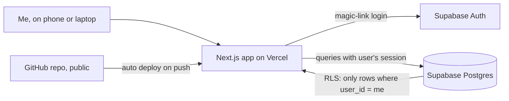

# Horizon — Product Brief (v1)

> **Purpose of this repo.** This project shows product definition and the ability to hand work to an AI agent. The product vision, requirements and decisions are mine (Anna-Marie Edeleanu). The implementation is delegated to an AI coding agent (Claude Code), and I review it against this brief. This file is the brief the agent works from.

---

## 1. Vision

A calm, personal "things to do" app that helps you **focus on what's in front of you now**, and trust that everything further down the road is held safely out of sight.

People are good at noticing what's in the way of a task (deadlines, where they need to be, how they feel). But weighing all of those factors together to decide *what to do next* is draining. Horizon does that weighing and shows a short ordered list.

### Why "Horizon"
Horizon is about presence, not output or being "prepared for everything". You only see as far as the horizon: the present and near future. What comes later is real and accounted for, but it isn't in view until it's relevant. Zooming out shows the road ahead, but the default is what's in front of you.

### Metaphor and naming
The product uses a gentle spatial metaphor:
- **Horizon** (fixed name): the product, and the limit of what's in view right now.
- **Roadmap** (fixed name): the zoomed-out timeline of what's further down the road (v3).
- **Placeholder names, likely to change:** *Orbit* is all the tasks you're carrying, which are always with you but not all in focus. *Radar* is the few tasks surfaced as worth your attention now. *Views* and *Blocks* are curated subsets.

Placeholder names must be easy to rename. Keep user-facing labels in a single place (e.g. one copy/labels file), and use neutral names in code and the database (e.g. `tasks`, `focus_list`, `saved_filters`, `blocks`), not the metaphor words.

**Tone and feel:** encouraging and non-demanding. It's about peace of mind and lower cognitive load, not productivity or efficiency. No guilt language, red alarms or streaks. Use UK English.

**Principles**
- Keep it simple, and let the list change as things change.
- Limit what's visible, but reassure the user that nothing is lost or forgotten.
- A task only appears when it can actually be done.
- Changing a score should be quick from every view, while the full detail doesn't need to be visible.

---

## 2. Stack (decided)

| Part | Choice | Notes |
|---|---|---|
| App | Next.js (App Router) + TypeScript | Deployed on Vercel (Hobby plan, personal use) |
| Database | Supabase Postgres | Region: Sydney (`ap-southeast-2`) |
| Auth | Supabase Auth, email magic link | **Public sign-up disabled** |
| Access control | Postgres Row Level Security (RLS) on every table | Each row has a `user_id`, and users can only read/write their own rows |
| Styling | Agent's choice (e.g. Tailwind) | Mobile-first, works well on a phone |
| Tests | Agent's choice (e.g. Vitest) | Required for scoring and visibility logic |
| Migrations | Supabase CLI migrations in `supabase/migrations/`, applied by a GitHub Action | Runs only on merge to `main`. See section 8 |

There's no separate backend server. The app talks to Supabase directly, and RLS enforces privacy.

---

## 3. Users and accounts

- **Me:** the only real user. I'm created manually in the Supabase dashboard.
- **Demo account:** loaded with fake seed data so others can try the app. Its credentials are set via environment variables or the dashboard, never committed.
- There's no public sign-up page, so the login screen only signs in existing accounts.

---

## 4. Core concepts

### Task
- `title`, optional `description`
- **Scores (1–5):** `effort`, `impact`, `urgency`. **Urgency is how soon the user feels it needs doing, independent of any deadline** (see section 6).
- **Environment** (one, from an editable list): Home, Computer, Errands, Office, Open hours, Private
- **State** (one, from an editable list): Focused, Productive, Social, Low energy
- **Optional hard deadline** (date, optional time)
- **Optional event link** with a relation: `before`, `during` or `after` (see timing rules)
- `done` flag, which can be undone. Done tasks are hidden from the Radar but kept, never deleted.

### Step
- Belongs to a task. Has a `title`, `order` and `done` flag.
- The Radar shows the task with its **first not-done step** as a subheading.
- In v1, steps inherit the task's timing. Step-level deadlines and events are out of scope.

### Event
- `name`, `start`, optional `end`
- Events are fluid anchors, not hard limits (e.g. "UK holiday", "Dinner with John").

### Environment and State lists
- Seeded with the defaults above for each user. The user can add, rename and remove items.

---

## 5. Timing rules (important)

A **deadline** is fixed and hard. An **event** is a soft anchor with room for judgement. A task can have either, both or neither.

| Setup | Visible on Radar | How urgency behaves |
|---|---|---|
| Deadline only | Always | Increases as the deadline nears; overdue is highest |
| Event `before` | Until the event starts | Increases gently as the event nears. It's soft and never marked "overdue" because of an event |
| Event `during` | Only between event start and end (no end → event day only) | Normal scoring while visible |
| Event `after` | Only once the event has started (or ended, if it has an end) | Normal scoring once visible |
| Event + deadline | Visibility follows the event rule | Urgency follows the deadline. **The deadline always wins as the hard limit** |

**Example:** "Send birthday card", linked `during` "Holiday" (so there's a holiday photo), with deadline Sunday (so it arrives by Wednesday). It's hidden until the holiday starts. Once visible, urgency is driven by Sunday.

**Conflicts:** if a deadline falls before the point where the task can become visible (e.g. `after` an event that starts after the deadline), show a gentle warning when saving. Don't block the save.

**Overdue:** overdue tasks rank at the top. If a task is still not done, gently prompt the user to adjust the deadline or let it go. Use calm wording.

Store all times in UTC and display them in the user's timezone (default `Australia/Sydney`).

---

## 6. Prioritisation model

Three separate layers decide what the user sees and in what order:

| Layer | Question it answers | Driven by |
|---|---|---|
| 1. Visibility | *Can* this be done now? | Event links (section 5) |
| 2. Priority score | How much does this task matter, on its own? | Impact, effort, urgency, deadline pressure |
| 3. Ordering | Given everything visible, what's a good sequence? | Priority score + list-level adjustments |

### Layer 2: priority score (per task)

**Urgency and deadline are different things:**
- **Urgency** (user-set, 1–5) is how soon *I* feel it needs doing. Many urgent things have no deadline.
- **Deadline pressure** (computed) rises as a hard deadline approaches. **It's scaled by impact**: missing a deadline on something that matters a lot should push hard, while missing one with a small consequence should only nudge.

| Example | Urgency | Deadline | Impact | Result |
|---|---|---|---|---|
| Buy toilet paper | 5 | none | 2 | High, driven by urgency |
| Submit tax return (owed money) | 4 | in 4 months | 4 | High now, driven by urgency, not the far deadline |
| Book zoo tickets online (30% off) | 1 | Wednesday | 1 | Moderate near Wednesday, only a nudge because impact is low |

**Effort balances; it doesn't punish.** High-effort, high-impact tasks must still rank well. Getting them done is a big relief, and the app shouldn't encourage avoiding hard things. Effort mainly affects ordering (layer 3), not whether something is important.

### Layer 3: ordering (across the visible list)

Start from the priority score, then apply gentle, explainable adjustments:
- **Quick-win bump:** a low-effort, low-impact task that has been sitting there a while gets bumped up, so it can just be cleared.
- **Spread deadline clusters:** when several tasks share a similar deadline, bring some forward earlier so there isn't a pile-up just before it. Use effort as a rough measure of workload.
- **Mix effort:** avoid several high-effort tasks back to back at the top of the list. Interleave lighter ones.
- **Overdue** tasks stay at the top (section 5).

### Requirements
- The agent **proposes** the exact formulas and weights in `PLAN.md`, based on the intent above.
- Layer 2 and layer 3 each live in **pure functions** with weights kept in one config object, so I can tune them later.
- Unit tests cover the three examples in the table above, plus each layer 3 adjustment.
- Each task shows a short "why it's here" line (e.g. "Urgent", "Due Wed", "Been waiting a while — quick win", "Brought forward: busy week ahead").
- The README explains the model in plain language.

### Activity history (data now, insights later)
Record an append-only log of task events: created, completed, undone, deleted, deadline changed, scores changed, steps completed, with timestamps. **v1 only stores this; it doesn't analyse it.** It also supplies the "been sitting a while" signal for layer 3.

In the future it can reveal patterns worth prompting about: tasks left undone for a long time while doable, tasks added and removed quickly, deadlines that keep moving, and what tends to get ticked off.

---

## 7. Screens (v1)

1. **Login:** magic link only.
2. **Radar** *(placeholder name)* ("where should my attention go?"), the home screen:
   - An ordered list of visible, not-done tasks, highest priority first, each with its first open step.
   - **Capped** at a short list (default 5), with a calm "show more" option.
   - Filters: environment, state, overdue only.
   - Quick actions on each task: mark done, mark the next step done, and adjust the effort, impact and urgency scores inline.
3. **Views:** save the current filter combination as a named View (e.g. "At home, productive", "At home, low energy", "Driving day, low social"). Pick a View to apply it.
4. **Task editor:** create and edit a task, its steps, scores, environment, state, deadline and event link (showing any conflict warning).
5. **Events:** list, create, edit and delete events.
6. **All tasks / Done** (the *Orbit*, placeholder name): a full list including done items, where tasks can be marked undone. This reassures the user that nothing is lost.
7. **Settings:** edit the Environment and State lists.

---

## 8. Requirements and edge cases

- **Privacy:** RLS is enabled on every table. A user can never read or write another user's rows, and tests or a documented manual check prove it.
- **No secrets in the repo.** `.env*` goes in `.gitignore`. Only the Supabase URL and anon (public) key are used client-side. The `service_role` key is never used in the app or committed.
- **No real data in the repo.** The seed file contains fake demo data only.
- **All schema changes go through migrations.** Every table, column, index, RLS policy and function is a timestamped SQL file in `supabase/migrations/`. Never ask me to run SQL by hand or edit tables in the dashboard. Never edit a migration that has already been merged; add a new one instead.
- **Migration pipeline:** a GitHub Actions workflow runs `supabase db push` **only on push to `main`** (i.e. when I merge a PR). It uses repo secrets `SUPABASE_ACCESS_TOKEN`, `SUPABASE_DB_PASSWORD` and `SUPABASE_PROJECT_ID`. The workflow must never print secrets or run on other branches or on pull requests. The agent never has database credentials.
- Empty states are friendly (no tasks, no events, all done).
- Deleting an event that tasks are linked to asks what to do: unlink the tasks (they keep any deadline) or cancel.
- Deleting a task needs confirmation. "Done" is the normal path; delete is for mistakes.
- Validation: the title is required, scores must be 1–5, and an event's end can't be before its start.
- Errors: user-friendly messages with no stack traces in the UI, and the app doesn't crash on network failure.
- Scale: one user with hundreds of tasks. No need to optimise further.
- No AI or third-party calls with task data.

---

## 9. Out of scope for v1 (future phases)

- **v2: Blocks.** Lists of tasks the user curates by hand (e.g. "Admin block", "Holiday block", "Errands block") and assigns to a day and part of the day (morning, evening, all day). Starting a block shows only its tasks, to avoid distraction.
- **v3: Roadmap.** A zoomable timeline of what's coming up (tomorrow → next month → next year) showing events, deadlines and blocks. Possibly step-level timing.
- **Later:** pattern insights and gentle prompts from the activity history (section 6), recurring tasks (monthly bills, annual MOT), prompts for stale or invisible tasks, and "Questions" as a task type (make a decision, get information, get advice).

Design the data model so these can be added without a rewrite, but **don't build them**.

---

## 10. Definition of done (v1)

- [ ] I can log in by magic link. Public sign-up is off.
- [ ] I can create, edit, complete, undo and delete tasks with steps, scores, environment, state, deadline and event link.
- [ ] I can create, edit and delete events.
- [ ] The Radar shows a capped, ranked list that follows the timing rules in section 5, with filters and saved Views.
- [ ] Every task on the Radar shows its first open step and a "why it's ranked here" line.
- [ ] Unit tests cover every visibility rule in section 5 (including the birthday-card example), the three score examples in section 6, and each ordering adjustment, and they pass.
- [ ] Activity history is recorded for every task change.
- [ ] RLS is on for every table. `SECURITY.md` explains how to verify that the demo account can't see my data.
- [ ] A seed script creates the demo account's fake data.
- [ ] `README.md` explains the project purpose, how the score works, and the screens.
- [ ] The whole schema (including RLS) is in `supabase/migrations/`, and the GitHub Action applies it on merge to `main`.
- [ ] `DEPLOY.md` gives step-by-step one-time setup: create the Supabase project, add the three GitHub secrets, disable sign-up, create users, connect Vercel, set env vars.
- [ ] `ASSUMPTIONS.md` lists every decision the agent made that this brief didn't cover.
- [ ] The app builds with no type errors and works on a phone-sized screen.

---

## 11. How to work (instructions for the agent)

**Run 1 (plan only):**
1. Read this brief fully.
2. Write `PLAN.md`: your understanding of the product in your own words, the data model (tables, key columns, relationships), the access rules, the folder structure, the proposed priority score and ordering formulas (section 6), and the build order.
3. Write `QUESTIONS.md`: anything ambiguous, missing or contradictory, about both the tech and the vision.
4. **Stop. Don't write application code yet.**

**Run 2 (build), after I answer the questions:**
- Build v1 to the definition of done. Don't stop to ask; record any judgement calls in `ASSUMPTIONS.md`.
- Database changes go in Supabase migration files only (section 8). The GitHub Action applies them when I merge.
- Commit in small, logical steps with clear messages, and open a pull request at the end summarising what was built and what to check.
